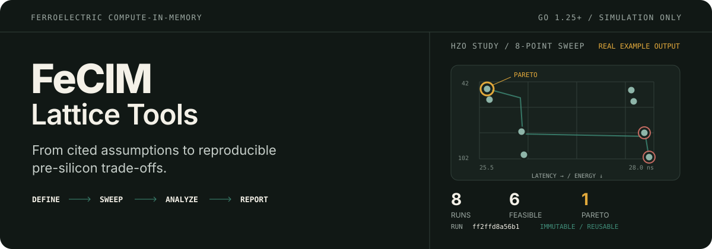
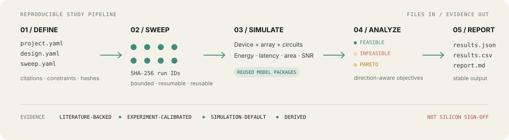
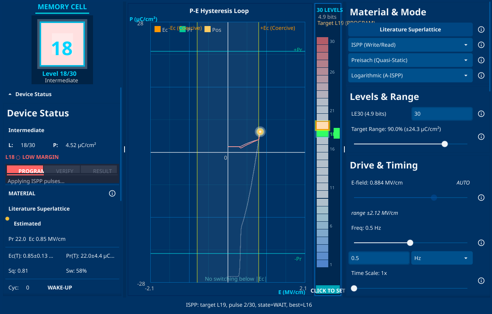

# FeCIM Lattice Tools

<p align="center">
  
</p>

<p align="center">
  <a href="https://github.com/TrebuchetDynamics/fecim-lattice-tools/actions/workflows/ci.yml"></a>
  <a href="https://go.dev"></a>
  <a href="https://fyne.io"></a>
  <a href="./LICENSE"></a>
</p>

FeCIM Lattice Tools is a **simulation-only research and design workbench** for ferroelectric compute-in-memory systems. Its headless Go core resolves device, array, and circuit assumptions into deterministic sweeps; its Fyne expert workspaces expose the underlying physics and design modules. Current energy, area, and peripheral models are simplified literature-informed estimates, not calibrated device/layout predictions.

> [!IMPORTANT]
> Outputs are simulation estimates—not measured silicon, foundry sign-off, or proof that a fabricated device will meet a reported metric. Every quantitative result must retain its model, assumptions, evidence level, and source run.

## Reproducibility demonstration

The checked-in HZO example expands three parameters into eight immutable runs. On the current models it produces six feasible points and one Pareto point. **This demonstrates repeatable execution and run reuse—not physics validation, hardware performance, or an experimentally established optimum.** Feasibility and Pareto status are relative to the example’s configured constraints, objectives, and simplified models:

```console
$ go run ./cmd/fecim-lattice-tools experiment run /tmp/fecim-study \
    -workers 2 -citation-dir citations/papers
total=8 reused=0 failed=0 feasible=6 pareto=1

$ go run ./cmd/fecim-lattice-tools experiment run /tmp/fecim-study \
    -workers 4 -citation-dir citations/papers
total=8 reused=8 failed=0 feasible=6 pareto=1
```

The second invocation reuses the same SHA-256-addressed runs. Worker count does not alter run identity or report content. Generated artifacts are plain files:

```text
runs/<sha256>/
├── manifest.json        resolved identity and provenance
├── resolved-design.json exact evaluated design
└── result.json          metrics, units, models, assumptions, evidence

reports/
├── results.json         structured study output
├── results.csv          stable tabular metrics
└── report.md            readable trade-off report
```

## One study, five explicit stages

<p align="center">
  
</p>

| Stage        | What stays inspectable                                                                    |
| ------------ | ----------------------------------------------------------------------------------------- |
| **Define**   | Hypothesis, citations, objectives, constraints, physical units, and input hashes in YAML. |
| **Sweep**    | Finite Cartesian points, deterministic seeds, stable run IDs, and bounded concurrency.    |
| **Simulate** | Device, array, DAC/ADC/TIA, energy, latency, area, and SNR model provenance.              |
| **Analyze**  | Successful, failed, feasible, infeasible, unusable, and direction-aware Pareto states.    |
| **Report**   | Deterministic JSON, CSV, and Markdown without runtime timestamps contaminating results.   |

Read the [workbench guide](./docs/guides/research-design-workbench.md) for the bundle schema, supported sweep paths, run reuse, and result semantics.

The repository exposes both a local CLI workbench and a Fyne desktop shell. Use the CLI for repeatable studies; use the Fyne workbench’s **Configure starter sweep…** action to create an HZO study without hand-editing YAML. Other workspaces expose device, array, circuit, inference, comparison, EDA, and documentation behavior.

## Run your first study

### Prerequisites

- Go 1.25 or newer
- A CGO-capable desktop toolchain only when running the Fyne interface
- No API keys, cloud services, database, or daemon

### 1. Copy the reproducible example

Generated runs are intentionally not committed into the example directory:

```bash
git clone https://github.com/TrebuchetDynamics/fecim-lattice-tools.git
cd fecim-lattice-tools
cp -R examples/research-design-workbench /tmp/fecim-study
```

### 2. Validate, run, and regenerate

```bash
go run ./cmd/fecim-lattice-tools project validate /tmp/fecim-study \
  -citation-dir citations/papers

go run ./cmd/fecim-lattice-tools experiment run /tmp/fecim-study \
  -workers 2 -citation-dir citations/papers

go run ./cmd/fecim-lattice-tools report generate /tmp/fecim-study \
  -citation-dir citations/papers
```

`experiment run` already writes reports. `report generate` rebuilds them later from committed runs without rerunning the models.

### 3. Open the desktop workspaces

```bash
go run ./cmd/fecim-lattice-tools
```

Open a specific module directly:

```bash
go run ./cmd/fecim-lattice-tools --module hysteresis
go run ./cmd/fecim-lattice-tools --module crossbar
go run ./cmd/fecim-lattice-tools --module eda
```

## Expert workspaces

The desktop app keeps existing model surfaces available for inspection and teaching while the headless workbench owns reproducibility. The original hysteresis workspace is shown below; the module table is the fastest route to the other surfaces.

<p align="center">
  
</p>

| Workspace                          | Inspect and model                                                                        |
| ---------------------------------- | ---------------------------------------------------------------------------------------- |
| [Hysteresis](./module1-hysteresis) | Preisach and Landau–Khalatnikov behavior, P–E loops, material presets, and ISPP writes.  |
| [Crossbar](./module2-crossbar)     | Matrix-vector multiplication, conductance quantization, IR drop, sneak paths, and drift. |
| [MNIST](./module3-mnist)           | Example inference behavior under quantization and array constraints.                     |
| [Circuits](./module4-circuits)     | DAC, ADC, TIA, read/program paths, PVT exploration, and ISPP control.                    |
| [Comparison](./module5-comparison) | Evidence-aware technology and architecture comparisons.                                  |
| [EDA](./module6-eda)               | SPICE, Verilog, Liberty, DEF, LEF, and OpenLane-oriented exports.                        |
| [Documentation](./module7-docs)    | Integrated references, model explanations, and educational material.                     |

## Scientific trust model

Results carry one of four evidence labels:

| Evidence                | Meaning                                                         |
| ----------------------- | --------------------------------------------------------------- |
| `literature-backed`     | Parameter or relationship is tied to a reviewed source record.  |
| `experiment-calibrated` | Value was calibrated against identified experimental input.     |
| `simulation-default`    | Explicit educational or exploratory default; not a measurement. |
| `derived`               | Computed from other recorded model inputs and assumptions.      |

The repository enforces these boundaries:

- External scientific claims belong in the Markdown-native [citation system](./citations/README.md).
- Verified, disputed, and removed claims are tracked in the [scientific honesty audit](./docs/research/honesty-audit.md).
- Project inputs stay inside their bundle and may be SHA-256 verified before use.
- YAML rejects unknown fields and non-finite physical values.
- Model-domain failures are preserved as results rather than silently discarded.
- The educational 30-level conductance baseline is configurable and is not presented as a validated device claim.

Use the tool to compare assumptions, test research hypotheses, and create reviewable pre-silicon studies. Do not use it as a foundry PDK, product benchmark, or substitute for device characterization.

## Architecture

```text
                         plain project bundle
                    project / design / sweep YAML
                                  │
                                  ▼
┌─────────────────────────────────────────────────────────────────┐
│ headless workbench core                                         │
│ strict load → deterministic expansion → bounded run execution   │
│             → feasibility / Pareto → stable reports             │
└──────────────────────────────┬──────────────────────────────────┘
                               │ thin adapters
             ┌─────────────────┼─────────────────┐
             ▼                 ▼                 ▼
      shared/system     shared/peripherals    existing modules
      area · energy     DAC · ADC · TIA      device · array · EDA
             └─────────────────┬─────────────────┘
                               ▼
                  immutable runs + JSON/CSV/MD

Fyne desktop shell ──► seven expert workspaces
validation/        ──► regression, literature, and integration checks
```

The core is local and file-based by design: no database, remote service, distributed scheduler, optimizer framework, or Rust rewrite. See the [architecture documentation](./docs/internals/architecture/ARCHITECTURE.md) and [workbench design](./docs/internals/superpowers/specs/2026-07-19-research-design-workbench-architecture-design.md).

## Validation and development

Behavior changes follow RED → GREEN → REFACTOR. The smallest complete verification set is:

```bash
go fmt ./...
go test ./...
make test-legacy-fyne
bash scripts/reproduce_validation.sh
```

Concurrency-sensitive workbench code also runs under the race detector:

```bash
go test -race ./workbench/...
```

Validation includes physics golden data, literature range checks, crossbar Kirchhoff-law checks, GUI integration tests, deterministic report checks, and CI on `main`. Passing validation does not promote a simulation default into measured evidence. Some literature-loop fixtures are provisional or model-generated; they are not independent experimental validation of the HZO workbench evaluator. See the [validation-figure evidence review](./docs/research/validation/landing-page-figure-readiness.md) for why a measured-versus-simulated headline plot is not yet presented.

## Project map

```text
workbench/              headless project, experiment, evaluator, and report core
cmd/                    desktop, CLI, and utility entry points
module1-hysteresis/     ferroelectric behavior and write control
module2-crossbar/       array simulation and non-idealities
module3-mnist/          constrained inference example
module4-circuits/       peripheral circuit models
module5-comparison/     evidence-aware comparisons
module6-eda/            EDA generation and integration
module7-docs/           integrated documentation viewer
shared/                 reused physics, system, peripheral, UI, and utility code
validation/             regression, literature, and integration checks
citations/              reviewable source records and fact registry
examples/               runnable project bundles and use cases
web/                    separate static Astro project site
```

## Documentation

- **Use:** [Installation](./docs/guides/installation.md) · [CLI reference](./docs/guides/cli-reference.md) · [Workbench guide](./docs/guides/research-design-workbench.md)
- **Understand:** [Architecture](./docs/internals/architecture/ARCHITECTURE.md) · [Configuration](./docs/internals/config-reference.md) · [Trust boundaries](./docs/guides/trust.md)
- **Validate:** [Testing](./docs/internals/testing/TESTING.md) · [Citation system](./citations/README.md) · [Honesty audit](./docs/research/honesty-audit.md)
- **Build:** [Contributing](./CONTRIBUTING.md) · [EDA integration](./module6-eda/examples/03-openlane-integration/README.md) · [Web project](./web/README.md)

## Citing this software

Citation metadata is provided in [`CITATION.cff`](./CITATION.cff). Until an archived release is published, record the exact Git commit alongside your project bundle and reports. No software DOI or JOSS acceptance is claimed. Release and submission preparation is tracked in the [readiness checklist](./docs/internals/release/research-software-readiness.md).

## Contributing

Issues and pull requests are welcome for stronger validation, experimental calibration, clearer model provenance, reproducible examples, and focused usability improvements. Start with [CONTRIBUTING.md](./CONTRIBUTING.md) and keep quantitative claims source-backed.

The separate [`web/`](./web) folder contains the Astro landing page; the Go/Fyne app and the research workbench remain the primary local tools.

## License

[MIT](./LICENSE) © Trebuchet Dynamics contributors.
